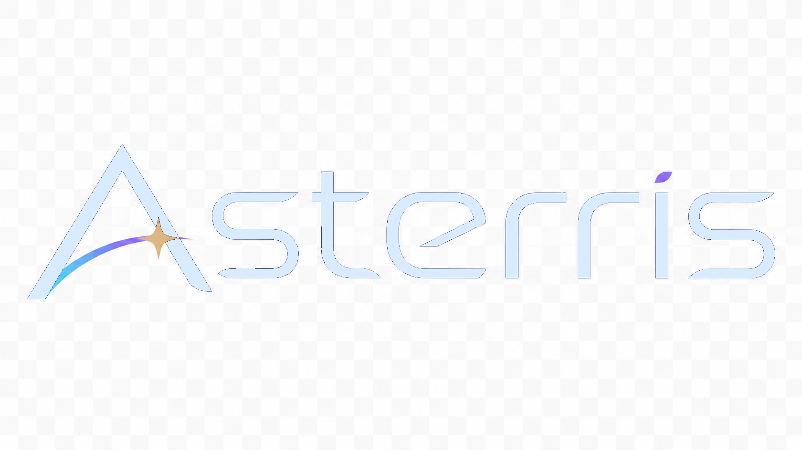

<div align="center">
  
  
  # Asterris

  **Advanced Planetary Exploration, Mission Engineering, and Scientific Simulation Platform**

  [](https://www.python.org/)
  [](https://streamlit.io/)
  [](https://www.docker.com/)
</div>
check out our app

   https://asterris-95blfcmhzca3kmnjajyvmq.streamlit.app/
   
## 📖 Overview

**Asterris** is a comprehensive, interactive platform built with Streamlit designed for planetary science, mission engineering, and geospatial analysis. It combines robust scientific engines, 3D terrain visualization, and physics-based simulations to aid in the planning, analysis, and execution of space exploration missions. 

Whether you are comparing planetary data with Earth analogs, simulating rover physics, or generating field campaign reports, Asterris provides a unified, AI-assisted interface for your mission control needs.

## ✨ Key Features

*   🌍 **Planetary & Geospatial Explorer:** Interactive 3D terrain viewers (powered by Three.js) and geospatial tile processing.
*   🚀 **Mission Engineering & Control:** Plan campaigns, optimize resources, and simulate mission variables (including rovers and drilling mechanics).
*   🔬 **Scientific Engine:** Advanced modules for Digital Elevation Models (DEM), subsurface analysis, spectral data, and planetary Machine Learning.
*   🧪 **Analog Discovery Lab:** Compare extraterrestrial datasets with global Earth analogs.
*   🤖 **AI Integration:** Built-in AI assistants and clustering algorithms to process complex mission data.
*   📊 **Reporting:** Automated generation of detailed field campaign and scientific reports.

## 📂 Project Structure

```text
Asterris-main/
├── ai/                     # AI assistant and ML clustering logic
├── assets/                 # Static assets, logos, JSON data, and 3D vendor libraries
├── components/             # Custom Streamlit UI components and 3D viewers
├── config/                 # Mission presets, settings, and planetary constants
├── data_sources/           # Data ingestion for live Earth, analogs, and subsurface catalogs
├── docs/                   # Architectural and development documentation
├── geospatial/             # Terrain and tile mapping utilities
├── optimization/           # Mission campaign optimization tools
├── reports/                # Automated report generators
├── scientific_engine/      # Core scientific modeling (DEM, ML, subsurface, validation)
├── simulations/            # Physics engines for rovers and drilling
├── tests/                  # Pytest suite for end-to-end and unit testing
├── views/                  # Streamlit application pages (Mission Control, Explorer, etc.)
├── app.py                  # Main Streamlit application entry point
├── Dockerfile              # Docker container configuration
├── docker-compose.yml      # Multi-container orchestration
└── requirements.txt        # Project Python dependencies
```

## 🚀 Getting Started

### Prerequisites

*   Python 3.9 or higher
*   [Docker](https://www.docker.com/) (Optional, for containerized deployment)

### Local Installation

1. **Clone the repository:**
   ```bash
   git clone https://github.com/your-username/Asterris.git
   cd Asterris
   ```

2. **Create a virtual environment (Recommended):**
   ```bash
   python -m venv venv
   source venv/bin/activate  # On Windows use: venv\Scripts\activate
   ```

3. **Install dependencies:**
   ```bash
   pip install -r requirements.txt
   # Install optional requirements if needed
   # pip install -r requirements-optional.txt
   ```

4. **Environment Variables:**
   Copy the example environment file and configure your API keys or database URLs.
   ```bash
   cp .env.example .env
   ```

5. **Run the Application:**
   ```bash
   streamlit run app.py
   ```

### Docker Deployment

To run Asterris in a fully containerized environment using Docker Compose:

```bash
docker-compose up --build
```
The application will be accessible at `http://localhost:8501`.

## 🧪 Testing

The project includes a robust test suite covering the scientific engine, physics simulations, and data discovery modules. To run the tests, ensure you have `pytest` installed and run:

```bash
pytest tests/
```

## 🛠 Development & Architecture

For detailed information on the scientific methodology, implementation status, and architecture, please refer to the documentation in the `docs/` directory:
*   [Architecture Guide](docs/architecture.md)
*   [Scientific Methodology](docs/scientific_methodology.md)
*   [Development Guide](docs/development_guide.md)

## 📄 License

[Insert License Information Here - e.g., MIT, GPLv3]

---
*Built with ❤️ for Planetary Exploration.*
